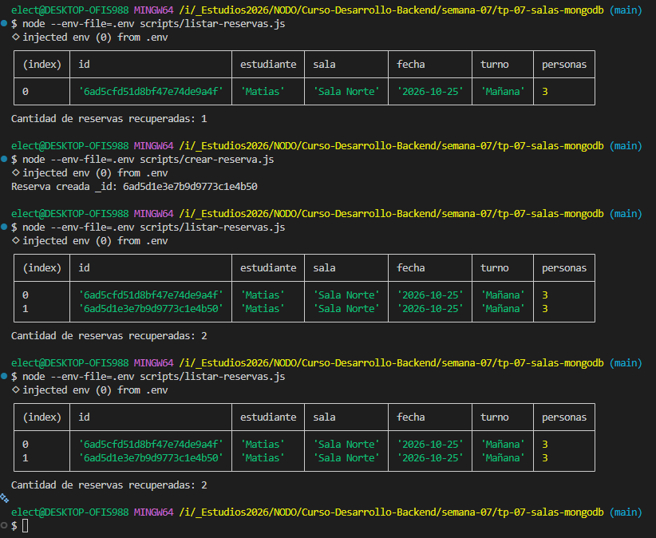
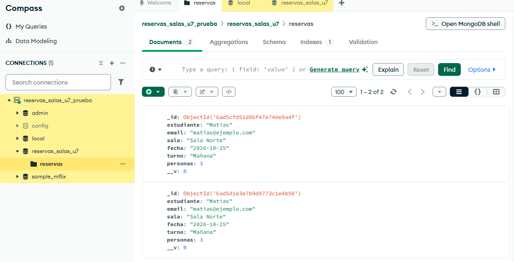
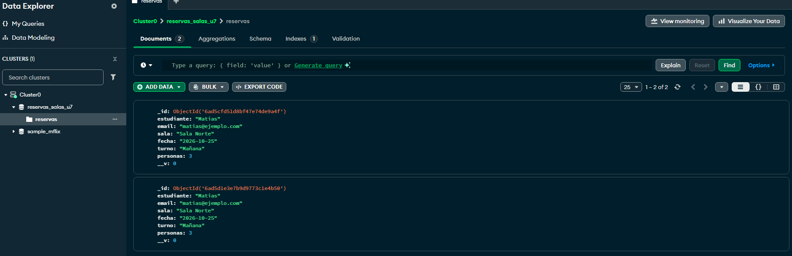

# TP 07 - Sistema de Reservas con MongoDB

### 1. Punto de partida
- **Repositorio/Copia:** `tp-07-salas-mongodb`
- **Punto de partida:** Codigo continuado del TP 06 (Sistema de Reservas en memoria con Express), agregando persistencia de datos mediante consola.

### 2. Versiones y Entorno
- **Node.js:** v20+ (Uso de `--env-file`)
- **Mongoose:** ^9.11.2
- **Base de Datos:** Se confirma el uso de **MongoDB Atlas Free Tier (M0)**.

### 3. Pasos de Instalacion y Preparacion
Desde una descarga nueva del repositorio, ejecutar los siguientes pasos:
1. Instalar las dependencias del proyecto: `npm install`
2. **Preparar MongoDB Atlas:** 
   - Crear un cluster gratuito (M0).
   - Crear un usuario de base de datos con contrasena.
   - Configurar la IP permitida en *Network Access* (ej: `0.0.0.0/0` para acceso global o IP especifica).
3. **Entorno:** Copiar la plantilla `.env.example` (o crear el archivo) como `.env` en la raiz del proyecto. Asignar la cadena de conexion valida a la variable `MONGO_URI`.

### 4. Diagnostico DNS y Comandos
- **Diagnostico DNS:** No se requirieron ajustes ni resolutores alternativos; la conexion a Atlas se establecio correctamente de forma directa.
- **Comandos utilizados:**
  - Conexion: `node --env-file=.env scripts/comprobar-conexion.js`
  - Creacion: `node --env-file=.env scripts/crear-reserva.js`
  - Listado: `node --env-file=.env scripts/listar-reservas.js`
  - Calidad de codigo: `npm run format` y `npm run check`
  - Arranque web: `npm start`

### 5. Mapa de Archivos y Conceptos Mongoose
**Archivos principales agregados:**
- `src/config/base-datos.js`: Logica de conexion a Atlas.
- `src/modelos/reserva.js`: Definicion del esquema y modelo.
- `scripts/`: Programas CLI para probar operaciones.

**Explicacion de conceptos:**
- **Esquema (Schema):** Define la estructura, los tipos de datos y las reglas de validacion de los documentos de reserva.
- **Modelo (Model):** Es el constructor compilado a partir del Esquema. Funciona como la interfaz que permite a Node.js realizar operaciones (CRUD) sobre la base de datos.
- **Coleccion:** Agrupacion de documentos en MongoDB. En este proyecto se llama `reservas` y se almacena en la base `reservas_salas_u7`.

### 6. Campos y Reglas de Validacion
- `estudiante`: String, obligatorio.
- `email`: String, obligatorio, validado con RegEx (requiere '@').
- `sala`: String, obligatorio, restringido a Enum.
- `fecha`: String/Date, obligatorio.
- `turno`: String, obligatorio, restringido a Enum.
- `personas`: Number, obligatorio, limite numerico (`min: 1`, `max: 6`).
- **Limites que todavia no se controlan:** No se valida la superposicion de turnos (dos reservas para la misma sala en la misma fecha y turno), ni si la fecha de la reserva corresponde a un dia en el pasado.

### 7. Matriz de Pruebas y Evidencia de Persistencia

**Evidencia visual:**
* **1. Transcripcion de ejecuciones en terminal:** 
* **2. Captura de MongoDB Compass (Opcional):** 
* **3. Captura de MongoDB Atlas (Requerido):** 

**Matriz de pruebas ejecutada:**
*(La base inicial contaba con 2 registros previos por la evidencia de persistencia)*

| Caso | Resultado esperado | Resultado observado | Cantidad Antes | Cantidad Despues |
| :--- | :--- | :--- | :---: | :---: |
| Conexion valida | Confirmacion y proceso terminado | Conexion exitosa a MongoDB Atlas | - | - |
| Fallo DNS | Registrar codigo y solucion | No ocurrio fallo de DNS en pruebas | - | - |
| Variable vacia | Fallo de configuracion | Error generico de conexion | - | - |
| Contrasena incorrecta | Fallo de autenticacion | Error: MongoServerError | 2 | 2 |
| Coleccion vacia | Listado de cantidad 0 | No aplicable (Base con registros) | - | - |
| Reserva valida | Se guarda y devuelve `_id` | Reserva creada _id: 6ad5cf... | 2 | 3 |
| Consulta desde nuevo proceso | Recupera ese `_id` | Recupero tabla con cantidad: 3 | 3 | 3 |
| Segunda consulta | No agrega registros | Recupero tabla con cantidad: 3 | 3 | 3 |
| Estudiante vacio | Rechazo, cantidad sin cambios | ValidationError: estudiante | 3 | 3 |
| Email sin @ | Rechazo, cantidad sin cambios | ValidationError: email | 3 | 3 |
| Sala no permitida | Rechazo, cantidad sin cambios | ValidationError: sala | 3 | 3 |
| Fecha vacia | Rechazo, cantidad sin cambios | ValidationError: fecha | 3 | 3 |
| Personas 0, 7 o 2.5 | Rechazo, cantidad sin cambios | ValidationError: personas | 3 | 3 |
| Personas texto | Rechazo de conversion | ValidationError / CastError | 3 | 3 |

### 8. Continuidad en Memoria y Proximos Pasos (Unidad 8)
La aplicacion web (`npm start`) continua funcionando de forma aislada utilizando un **arreglo en memoria** para almacenar las reservas (`src/servicios/reservas.js`). La persistencia desarrollada en este TP 07 se implemento unicamente a nivel de *scripts de consola* de manera segura para comprender el ODM Mongoose. 
**En la Unidad 8**, se abordara la integracion directa de Mongoose en las rutas y servicios de Express, reemplazando el almacenamiento en memoria volatil por la base de datos MongoDB Atlas.

### 9. Confirmacion de Seguridad
Se confirma que los archivos sensibles como el **`.env`** (que contiene la URI y credenciales), el directorio **`node_modules/`**, y cualquier dato personal o contrasena de cluster no han sido publicados en este repositorio gracias a las reglas configuradas en el `.gitignore`.