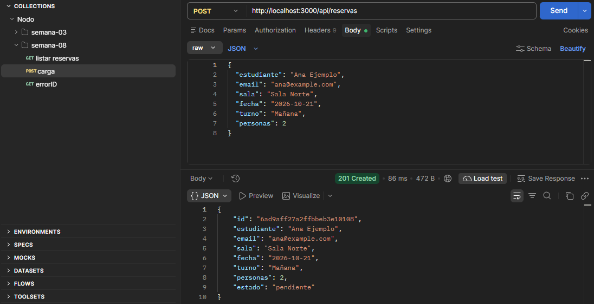
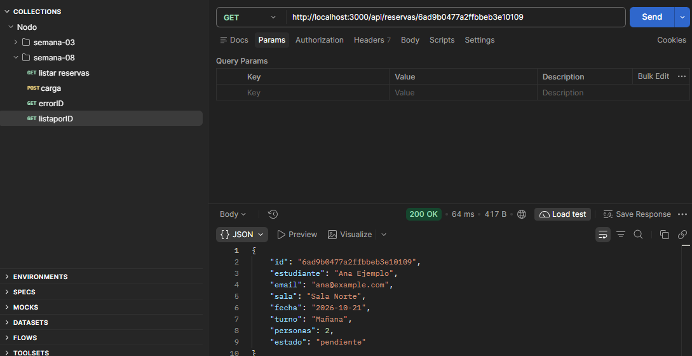
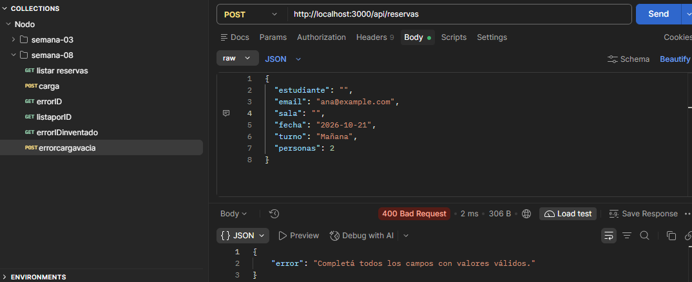
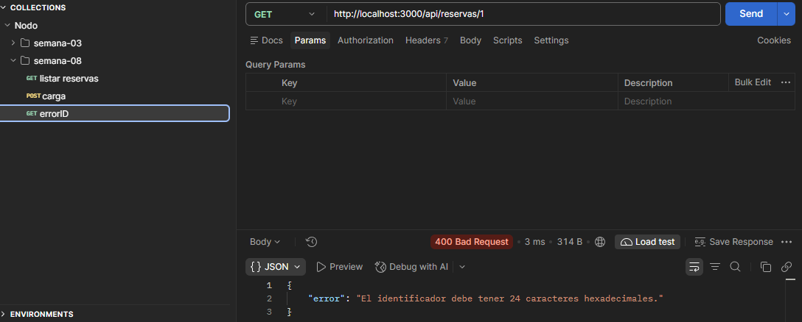
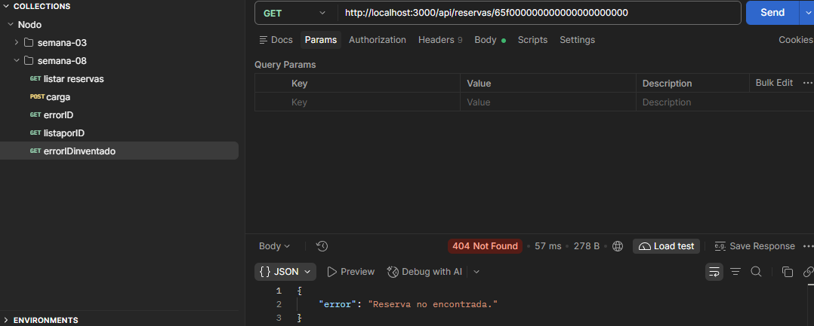

# TP 08 - Sistema de Reservas (MongoDB + API REST)

### De qué trata
Este es el TP 08, continuado a partir del TP 07. La principal diferencia es que reemplacé el almacenamiento en memoria por persistencia real en MongoDB Atlas usando Mongoose. Además, armé la arquitectura con inyección de dependencias y la app corre nativa con Node 20 (sin usar la librería `dotenv`).

### Cómo levantarlo
1. Ejecutá `npm install` para bajar las dependencias.
2. Copiá el archivo `.env.example`, renombralo a `.env` y pegá tu propia cadena de conexión de Atlas en `MONGO_URI`.
3. Levantá el servidor con `npm start` (el script ya tiene el flag `--env-file=.env`).

### Arquitectura y Cambios
- **Inyección de dependencias:** `app.js` instancia el servicio de Mongo una sola vez y lo pasa por parámetro a los controladores y middlewares.
- **Mongoose:** Agregué el esquema con el campo `estado: "pendiente"` por defecto. Al leer los datos, uso `.lean()` para traer objetos de JS limpios y formatear el `_id` a `id`.

### Endpoints
- **GET** `/api/reservas`: Devuelve el listado completo en JSON.
- **POST** `/api/reservas`: Crea una reserva validada. Devuelve estado `201 Created` y manda la URL del nuevo recurso en la cabecera `Location`. 
*(Nota: Incluí la colección exportada de Postman en el repo para probar rápido).*

### Evidencias y Pruebas en Postman
Dejo las capturas comprobando los casos que pide la rúbrica:

- 
- 
- 
- 
- 

**Matriz de resultados observados:**

| Caso | Resultado observado |
| :--- | :--- |
| Listado vacío (base nueva) | 200 OK, devuelve `[]` |
| Creación válida | 201 Created, devuelve cabecera Location y JSON con `estado: pendiente` |
| Consulta por ID real | 200 OK, devuelve los datos de la reserva |
| Prueba de reinicio | 200 OK. Apagué y prendí el servidor y los datos persisten. |
| ID demasiado corto ("1") | 400 Bad Request, lo frena la validación |
| ID inventado de 24 chars | 404 Not Found |
| Envío de datos inválidos | 400 Bad Request, salta la validación del esquema (ej. campos vacíos o tipos incorrectos) |

### Seguridad
Los archivos sensibles como `.env` y el directorio `node_modules` están en el `.gitignore` para no filtrar contraseñas del cluster.