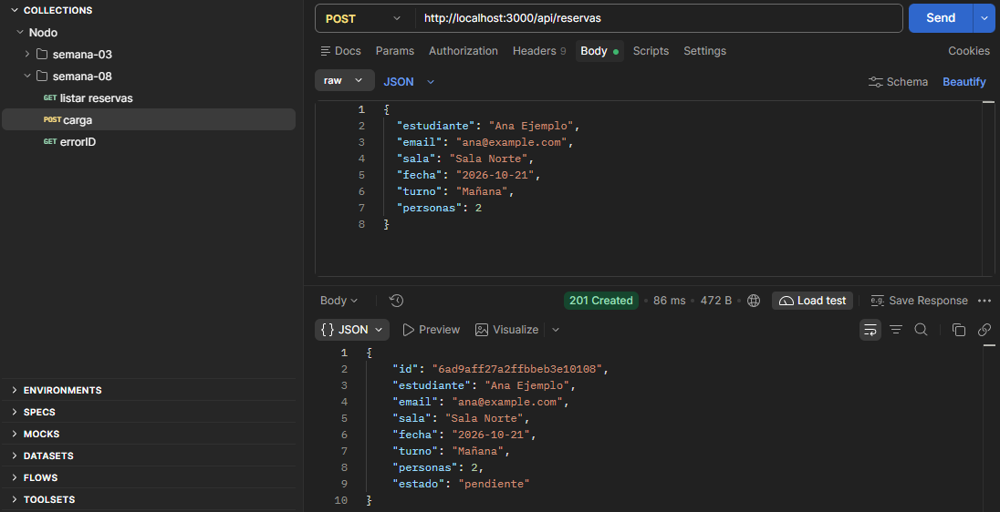
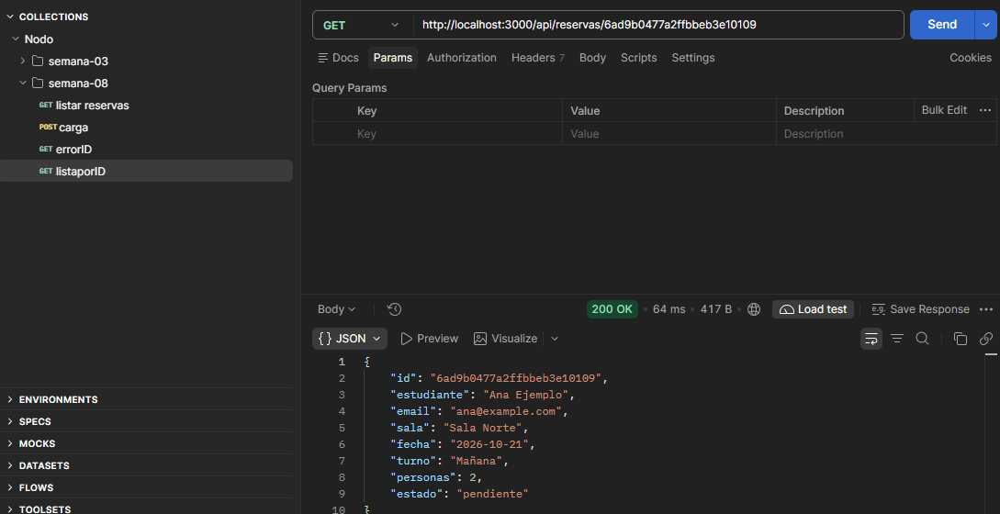
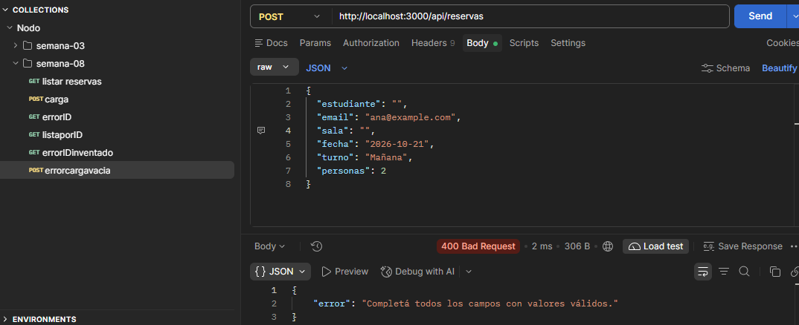
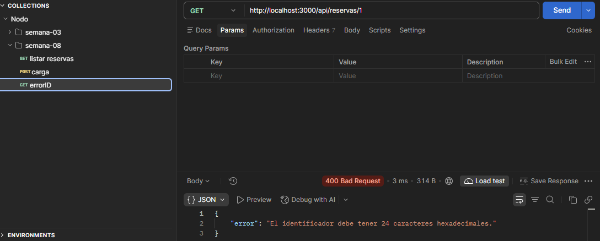
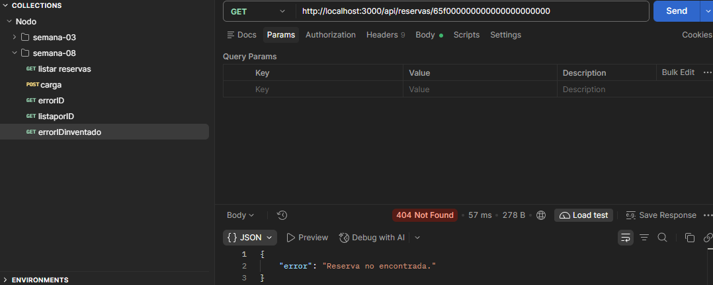

# TP 09 - Sistema de Reservas (CRUD completo en MongoDB)

### De qué trata
Este es el TP 09, continuación del TP 08. En esta etapa implementé el ciclo CRUD completo (Crear, Leer, Actualizar y Borrar) utilizando persistencia real en MongoDB Atlas. La API ahora maneja reemplazos completos (PUT), modificaciones parciales (PATCH) y borrado físico (DELETE), utilizando validaciones estrictas y conectándose a una nueva base de datos (`reservas_salas_u9`). 

Mantuve la arquitectura de inyección de dependencias y la ejecución nativa con Node 20 (`--env-file=.env`).

### Cómo levantarlo
1. Ejecutá `npm install` para bajar las dependencias.
2. Copiá el archivo `.env.example`, renombralo a `.env` y pegá tu propia cadena de conexión de Atlas (asegurando que apunte a la BD `reservas_salas_u9`).
3. Levantá el servidor con `npm start` (el script ya tiene el flag `--env-file=.env`).

### Arquitectura y Cambios
- **Inyección de dependencias:** `app.js` instancia el servicio de Mongo una sola vez y lo pasa por parámetro a los controladores y middlewares.
- **Mongoose:** Agregué el esquema con el campo `estado: "pendiente"` por defecto. Al leer los datos, uso `.lean()` para traer objetos de JS limpios y formatear el `_id` a `id`.

### Endpoints
- **GET** `/api/reservas`: Devuelve el listado completo en JSON.
- **GET** `/api/reservas/:id`: Devuelve el detalle de una reserva específica.
- **POST** `/api/reservas`: Crea una reserva validada. 
- **PUT** `/api/reservas/:id`: Reemplazo total del recurso (exige enviar todos los campos).
- **PATCH** `/api/reservas/:id`: Modificación parcial (sólo permite actualizar `personas` y `estado`).
- **DELETE** `/api/reservas/:id`: Eliminación física del documento en la base de datos.

### Evidencias y Pruebas en Postman (capturas de evidencia anteriores tp8)
Dejo las capturas comprobando los casos que pide la rúbrica:

- 
- 
- 
- 
- 

### Matriz de resultados observados (Pruebas Postman)

| Operación | Caso de Prueba | Resultado observado | Cambio en la Base de Datos |
| :--- | :--- | :--- | :--- |
| **POST** | Creación válida (6 campos) | `201 Created`. Devuelve JSON con el recurso creado y el `estado: pendiente` automático. | Pasa de 0 a 1 reserva. |
| **PUT** | Reemplazo completo válido | `200 OK`. Devuelve el recurso con los datos pisados (ej. `estado: confirmada`). | Se mantiene en 1 reserva (modificada). |
| **PUT** | Error por faltar un campo | `400 Bad Request`. Frena la petición indicando que faltan datos válidos. | Sin cambios. |
| **PATCH** | Actualización parcial válida | `200 OK`. Devuelve el recurso con la cantidad de `personas` actualizada a 3. | Se mantiene en 1 reserva (modificada). |
| **PATCH** | Error por campo no permitido | `400 Bad Request`. Frena la petición (ej. intentar cambiar la `fecha`). | Sin cambios. |
| **DELETE** | Borrado físico exitoso | `204 No Content`. No devuelve cuerpo, confirma la eliminación. | Pasa de 1 a 0 reservas. |
| **GET** | Verificación post-borrado | `404 Not Found`. Confirma que el ID ya no existe en la base. | Sigue en 0 reservas. |

### Seguridad
Los archivos sensibles como `.env` y el directorio `node_modules` están en el `.gitignore` para no filtrar la conexión del clúster de Atlas.